# 线激光条纹分割验证报告

扫描数据 V06_120，蓝色线激光，木质工件。本报告记录从"现成模型能否直接用"到"ResNet18 与 MobileNetV3 对比"的全部验证过程，结论放在最前面，过程按时间顺序展开。

## 1. 结论

| 问题 | 结论 |
|---|---|
| WLI 预训练模型能直接用于本扫描场景吗 | 不能。掩膜碎成 67 到 112 块，线缆和设备边缘大量误检 |
| 蓝色通道比灰度更适合吗 | 适合。蓝通道质心抖动 0.28 px，灰度 0.59 px |
| 在扫描数据上训练是否值得 | 值得，但瓶颈在标签不在骨干 |
| 之前的"断裂数"指标可信吗 | 不可信。它只统计标签里连通的一段被预测拆开，看不到标签自己就有的缺口 |
| 断线的真正原因 | 标签规则 B 不小于 200 会丢掉远场暗淡但连续的条纹。120 帧验证集里 70 帧标签有大于 30 px 的缺口 |
| 新的 v3 滞回标签有用吗 | 有用。ResNet18 在有证据的缺口上的误断帧数从 32 降到 0 |
| ResNet18 还是 MobileNetV3 | 先用 ResNet18。IoU 高 0.011，1080p 推理速度相同。MobileNetV3 只有单种子 |
| 换更强的解码器或骨干有用吗 | UNet++ 的 IoU 高 0.007，三个种子一致，但推理慢 3 倍。ResNet34 无明显提升。MAnet 训练不稳 |
| LSDNN 值得用吗 | 本轮不值得。直接按我们的协议训练 IoU 只有 0.65，欠拟合，未调参 |
| 换场景后模型还能用吗 | 不能。cam_snaps 的斜线宽条纹场景下，R18 只覆盖条纹一小部分，UNet++ 一半的帧检不出，传统质心失效，见第 14 节 |
| 结果可以直接信吗 | 还不能。只有木质，单次训练，标签仍是规则生成，中心点没有真值 |

最终配置如下。

| 项 | 取值 |
|---|---|
| 网络 | U-Net，ResNet18 编码器，ImageNet 初始化。精度优先且不在乎延迟时可换 UNet++ |
| 输入 | RGB 三通道，原始分辨率裁 512x384 训练 |
| 标签 | v3 滞回标签，种子为 B 不小于 200 的核心，沿脊线响应向外生长 |
| 损失 | BCE + Dice + 0.4 x clDice |
| 亚像素中心 | 取蓝通道，低阈值 0.6，关闭饱和分支 |
| 推理 | 1080p fp16 约 11.6 ms 加中心提取约 63 ms |

## 2. 数据

机械臂以 4 mm/s 移动，共 2986 张 1920x1080 彩色 JPEG。条纹接近竖直，木质场景，环境光下拍摄，镜头前没有带通滤光片。已有的传统方法配置在 `frozen/extraction.yaml`，为 steger、蓝通道门控强度、剖面半径 10、最大宽度 16。

训练集与验证集按时间块切分，避免相邻帧泄漏。

| 项 | 取值 |
|---|---|
| 抽帧 | 每 4 帧取 1 帧 |
| 分块 | 每 120 帧一块，每 6 块取 1 块作验证 |
| 隔离 | 验证块前后 12 帧不进训练集 |
| 数量 | 训练 598 张，验证 120 张 |

## 3. 第一步：WLI 预训练模型直接跑扫描帧

WLI 公开数据集是灰度图，背景较暗。取 3 张扫描帧直接喂给 WLI 预训练的 ResNet18 和 MobileNetV3。

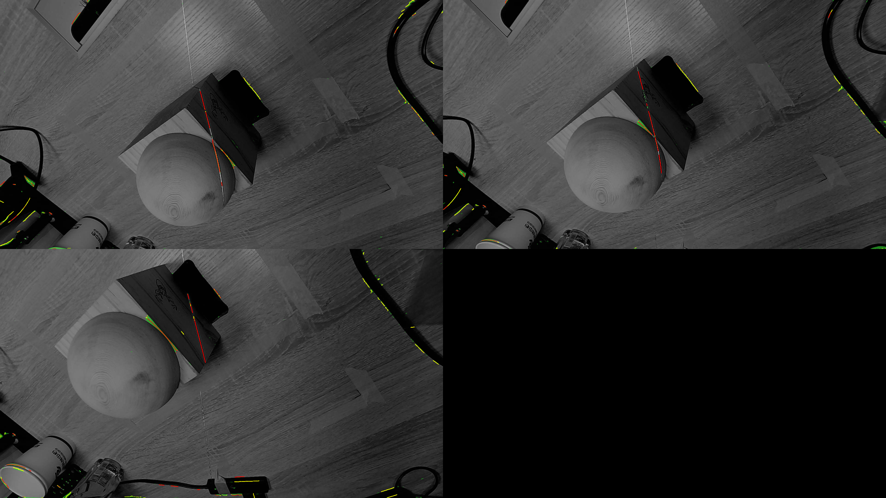

观察如下。

- 主条纹被切成很多段，整张图出现 67 到 112 个连通域。
- 右上黑色线缆、左下设备和杯子边缘都被当成条纹。
- 原因是域差距。WLI 模型只见过灰度图和暗背景，没见过带纹理的木地板和彩色杂物。

结论是必须用扫描数据重训，不存在直接迁移的可能。

## 4. 第二步：弄清条纹在彩色图里长什么样

先把条纹局部放大。

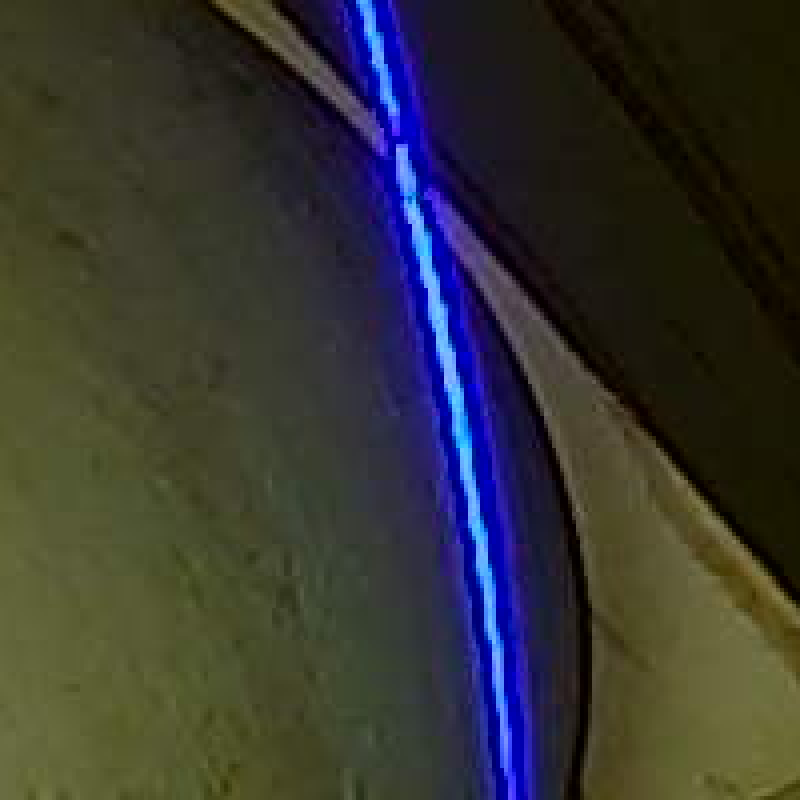

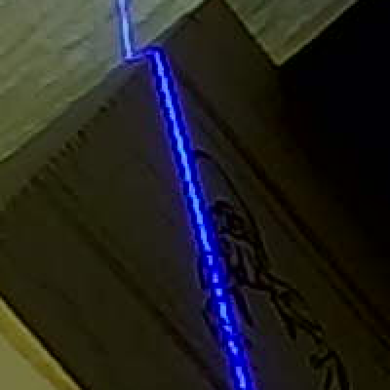

条纹由两部分组成。

| 部分 | 宽度 | 颜色 |
|---|---|---|
| 核心 | 约 3 px | B 饱和到 255，G 和 R 也亮，呈青白色 |
| 光晕 | 约正负 8 px | 只有蓝色，G 和 R 接近 0 |

另一个关键现象来自 JPEG 的 4:2:0 色度子采样。条纹沿线出现虚线状缺口，缺口处 G 和 R 被压成 0，而 B 仍然不小于 200。

## 5. 第三步：为什么改用蓝色通道

你提出激光是蓝色，应该用蓝色通道。我对 34 个条纹连通域做了测量。

| 指标 | 灰度 | 蓝通道 |
|---|---|---|
| 质心抖动 | 0.59 px | 0.28 px |
| 相对灰度核心的偏置，低阈值 0.3 | 0 | +0.29 px |
| 相对灰度核心的偏置，低阈值 0.6 | 0 | +0.10 px |

决定如下。

- 标签只看 B 通道。用 G 和 R 做规则会在虚线缺口处断开。
- 网络输入用 RGB，让网络自己区分条纹与蓝色以外的干扰。
- 中心提取用 B 通道，低阈值取 0.6，偏置压到 0.10 px。
- 关闭饱和分支，统一用低阈值加权质心。

## 6. 第四步：伪标签的两次迭代

没有人工标注，用颜色规则生成伪标签。

### 6.1 旧规则的缺陷

第一版规则要求 B、G、R 同时较亮，结果在虚线缺口处断开。

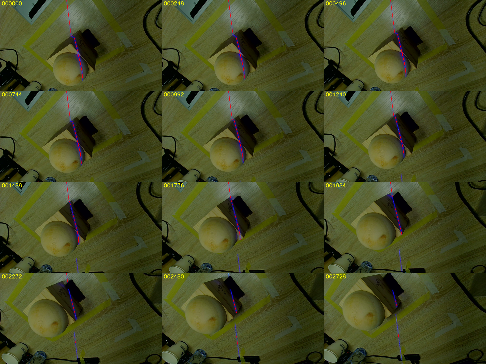

改成只用 B 通道后，缺口被连上。

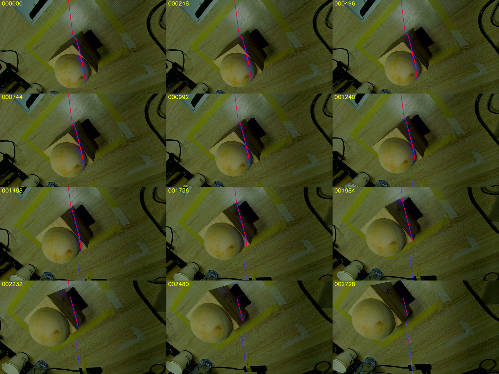

下图左为原图，中为严格规则，右为放宽后的规则，红色为标签。

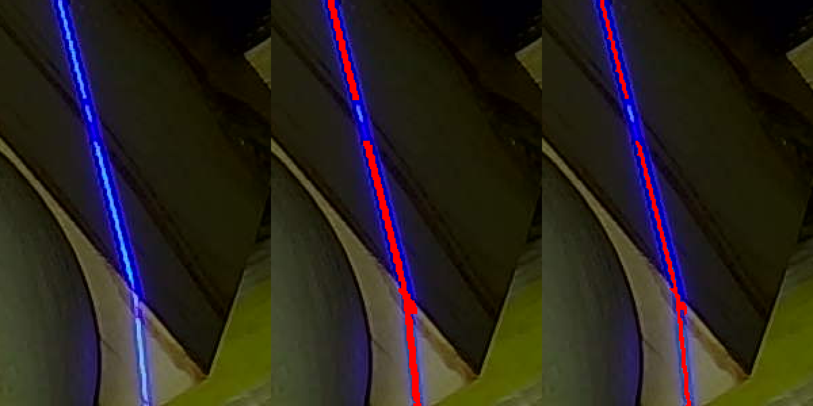

### 6.2 v1 标签与第一次训练

v1 标签使用较严的长度过滤，面积不小于 60，最大边不小于 60，厚度不超过 14。训练 80 个 epoch，结果如下。

| 指标 | v1 标签 ResNet18 |
|---|---|
| IoU | 0.896 |
| 断裂数 | 0.067 |
| 误检面积 | 82 px |

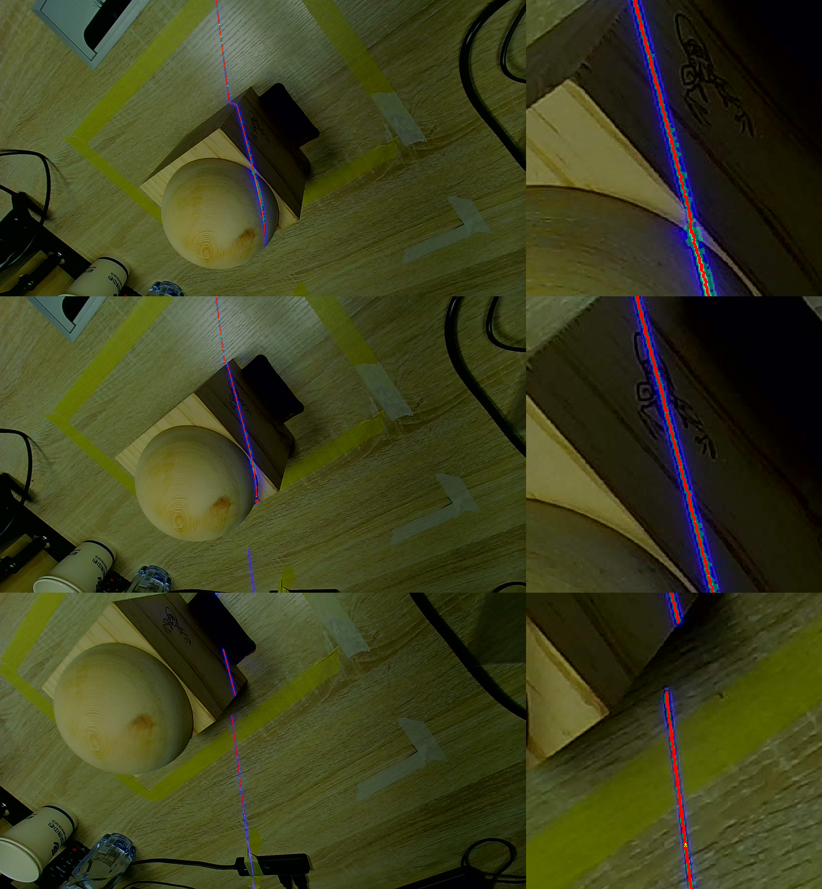

随后挑出效果最好和最差的帧查看。典型帧如下。

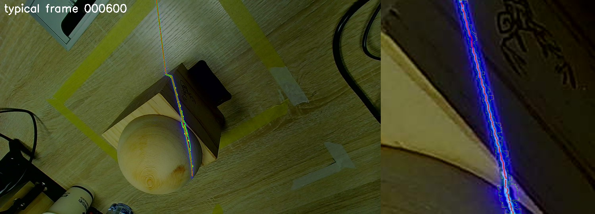

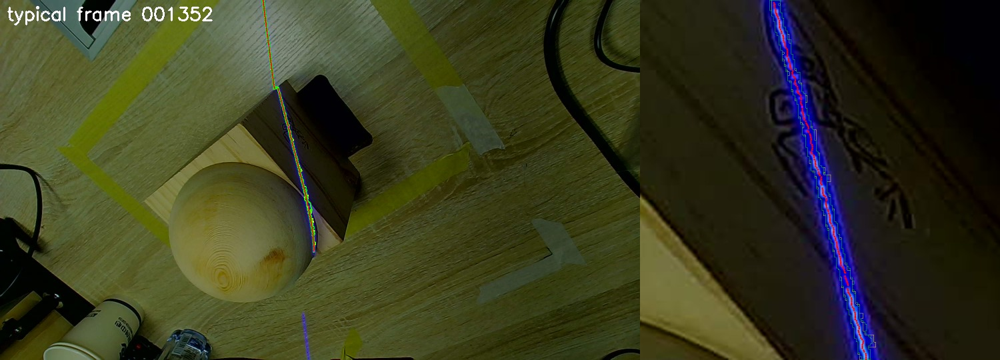

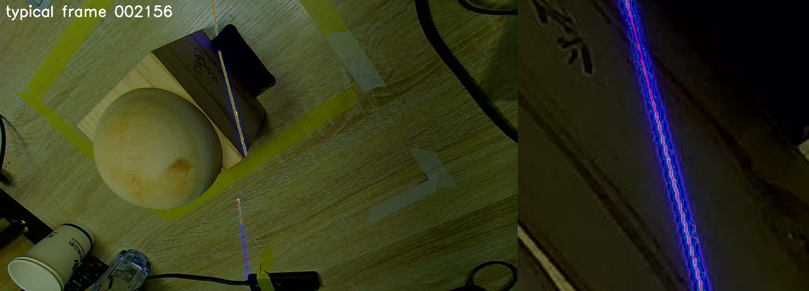

指标最差的几帧如下。

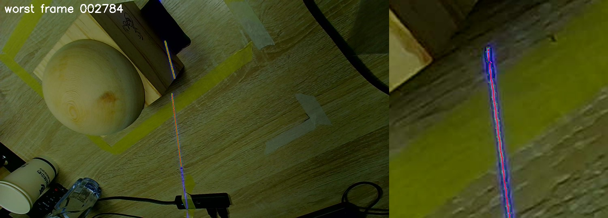

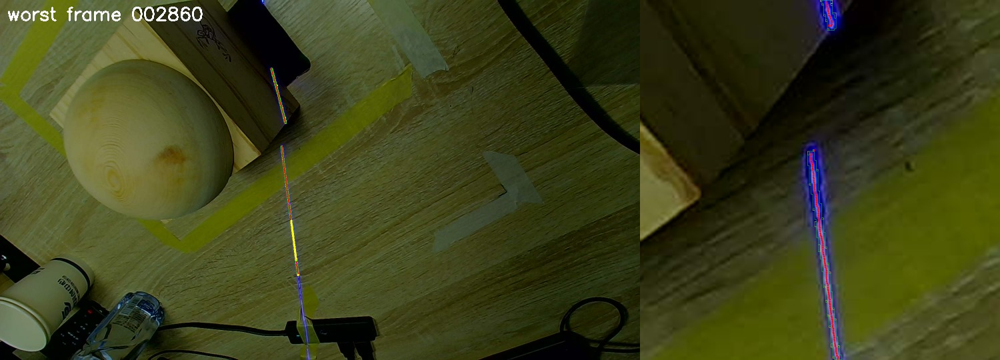

### 6.3 最差帧的"误检"其实是真条纹

最差帧里大量面积被判为"误检"。逐帧核对后发现，这些是桌面远场的暗淡条纹，被拆成不足 60 px 的短段，v1 标签的长度过滤把它们丢掉了。模型检测到了，而标签没有。

我做了两项检查。

- 在这些模型多出的像素上测 B 通道与背景的差，平均约 129。
- 55 帧里没有一帧属于证据偏弱。

所以问题出在标签而不在模型。v2 标签把长度过滤放宽为面积不小于 40、最大边不小于 25、厚度不超过 8，再配合 5x5 闭运算，把碎段补进标签。

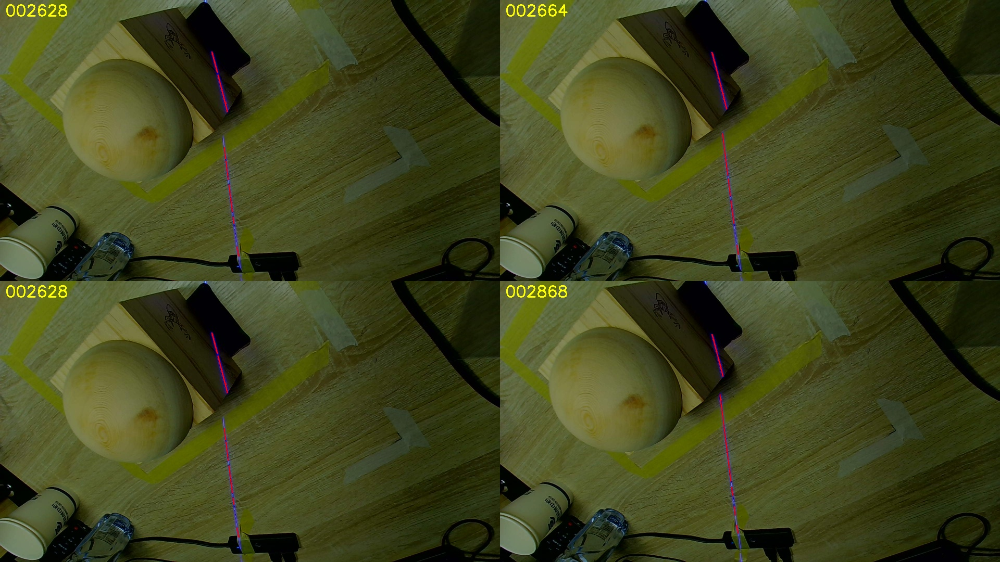

注意 v1 和 v2 的指标不能直接比较，因为标签不同。

## 7. 第五步：v2 标签上 ResNet18 与 MobileNetV3 对比

在 v2 标签上用同一数据切分、同一超参数、同一随机种子各训练 80 个 epoch。

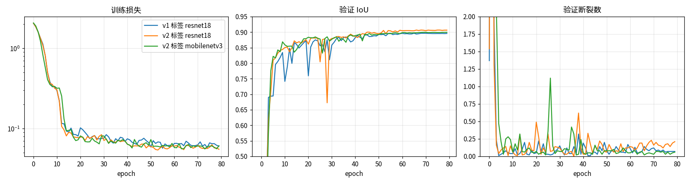

三条曲线在 60 个 epoch 以后基本收敛。MobileNetV3 在第 26 个 epoch 附近有一次断裂数尖峰，之后恢复。

### 7.1 指标

| 指标 | ResNet18 | MobileNetV3 |
|---|---|---|
| IoU | 0.9067 | 0.8995 |
| 断裂数 | 0.083 | 0.033 |
| 误检面积 px | 43 | 51 |
| 漏检超过 100 px 的帧数 | 3 | 10 |
| 参数量 M | 14.3 | 6.7 |
| 1080p fp16 耗时 ms | 11.6 | 11.5 |

### 7.2 逐帧比较

120 帧里 ResNet18 的 IoU 更高的有 95 帧，平均高 0.0073。

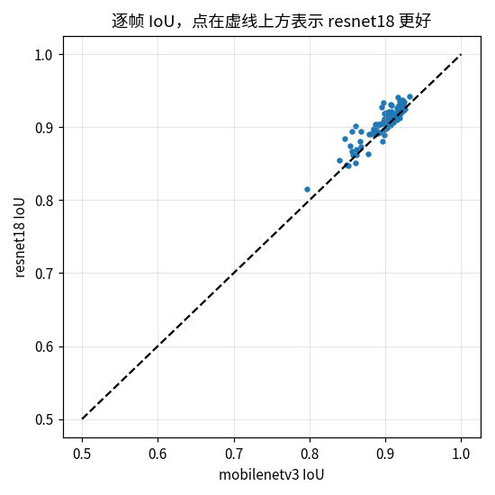

### 7.3 样例

绿色为命中，红色为标签有而模型漏掉，品红为模型多出。

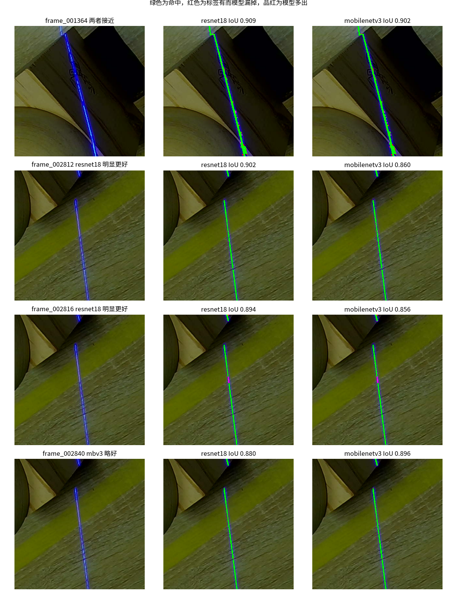

观察如下。

- 两个模型在大多数帧上几乎一致，差别只在条纹边缘一两个像素。
- 第二、三行是 ResNet18 明显更好的帧，位于扫描末段，条纹最暗最细。MobileNetV3 在这些帧里更容易漏掉条纹两端。
- 第三行中间的品红小段两个模型都有，对应标签本身的缺口，不算模型错误。
- 最后一行是 MobileNetV3 略好的帧，说明差异不是单向的。

### 7.4 当时的取舍与后来发现的问题

当时依据 IoU 和断裂数选了 ResNet18。但随后你指出仍有断线，复查发现表中的断裂数并不能反映连续性，见下一节。

## 8. 复盘：断线问题

### 8.1 断裂数指标的盲区

断裂数只统计"一个标签连通域被预测切成几段"。如果标签本身就有缺口，标签里就是两个独立的连通域，模型只要照着预测，断裂数仍是 0。统计验证集发现如下。

| 项 | 数值 |
|---|---|
| 标签有大于 30 px 缺口的帧 | 70 / 120 |
| 标签里大于 30 px 的缺口总数 | 116 |
| v2 ResNet18 预测有此类缺口的帧 | 60 / 120 |

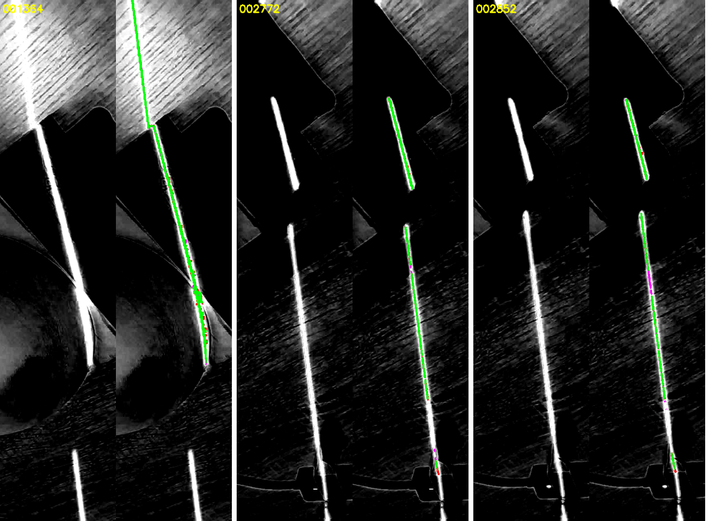

缺口分两类。

| 类型 | 例子 | 处理 |
|---|---|---|
| 真缺口 | 条纹落到边缘外，没有光 | 保留，不应补 |
| 标签伪影 | 桌面远场的暗淡条纹，B 不足 200，但把 B 通道拉亮后明显连续 | 应补 |

所以瓶颈是 B 不小于 200 这条标签规则，不是骨干网络。换更大的网络只会更忠实地复现缺口。

### 8.2 v3 滞回标签

做法类似边缘检测的滞回阈值。

| 步骤 | 内容 |
|---|---|
| 种子 | 原 v2 核心掩膜 |
| 候选 | 蓝通道平滑后减去中值背景大于 25，且 Hessian 脊线响应大于 6，5x5 闭运算 |
| 生长 | 只保留离种子 150 px 以内的候选 |
| 共线补段 | 没有种子但长度不小于 60、厚度不超过 10、近似竖直，且到两端种子拟合直线的横向距离不超过 50 px 的线段 |

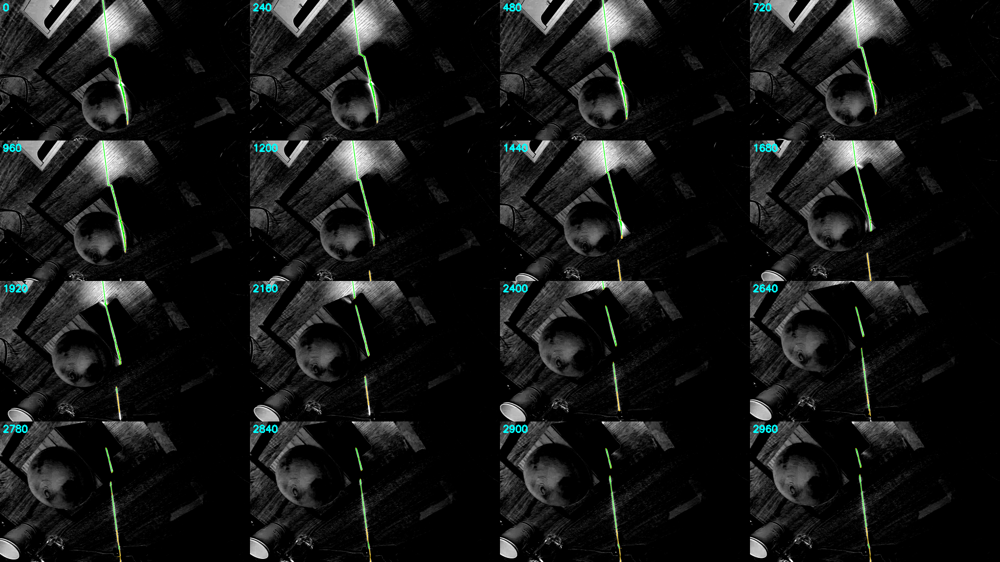

v2 与 v3 标签对比，红色为标签。

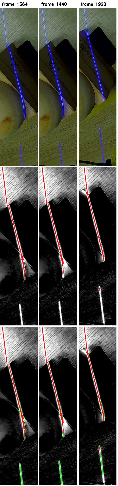

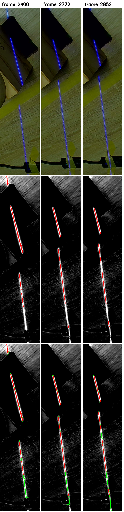

已知的小毛病有两处。帧 1364 球边缘有一小段多出的分支，帧 1920 线缆附近的底段没有标出来。

### 8.3 新的连续性指标

把预测碎片按纵向范围串起来，缺口长度不小于 12 px 时，取缺口两端点的连线，计算连线上落在背景证据图里的比例。比例不小于 0.6 记为误断，否则记为真缺口。

注意这个证据图和 v3 标签规则同属一类信号，所以 v3 标签与 v3 模型得 0 有一部分是循环论证。它能说明"模型学会了标签规则"，不能单独证明"模型在人眼看来连续"。

## 9. 用 v3 标签重训及 LSDNN 试验

三个模型使用相同切分、超参数、随机种子和损失，训练 80 个 epoch。LSDNN 用我们的 ResNet18 ImageNet 权重初始化。

### 9.1 指标

| 模型 | 训练标签 | IoU，对 v3 标签 | 误断帧数 | 误断数 | 参数量 M |
|---|---|---|---|---|---|
| U-Net ResNet18 | v2 | 0.712 | 32 / 120 | 36 | 14.3 |
| U-Net MobileNetV3 | v2 | 0.711 | 24 / 120 | 26 | 6.7 |
| U-Net ResNet18 | v3 | 0.898 | 0 / 120 | 0 | 14.3 |
| U-Net MobileNetV3 | v3 | 0.886 | 0 / 120 | 0 | 6.7 |
| LSDNN ResNet18 | v3 | 0.653 | 0 / 120 | 0 | 21.6 |

读表要点如下。

- v2 训练的模型拿 v3 标签评分，IoU 只有 0.71，不能与 v3 模型的 0.89 比较，两者标签不同。
- 误断帧数才是这一轮最直接的证据，v2 模型有 24 到 32 帧在有证据的位置断开，v3 模型为 0。
- 1080p fp16 推理，ResNet18 为 11.6 ms，MobileNetV3 为 11.4 ms，LSDNN 为 6.1 ms。

### 9.2 样例

绿色为命中，红色为标签有而模型漏掉，品红为模型多出。每个面板三列为三帧，背景为拉亮的 B 通道。

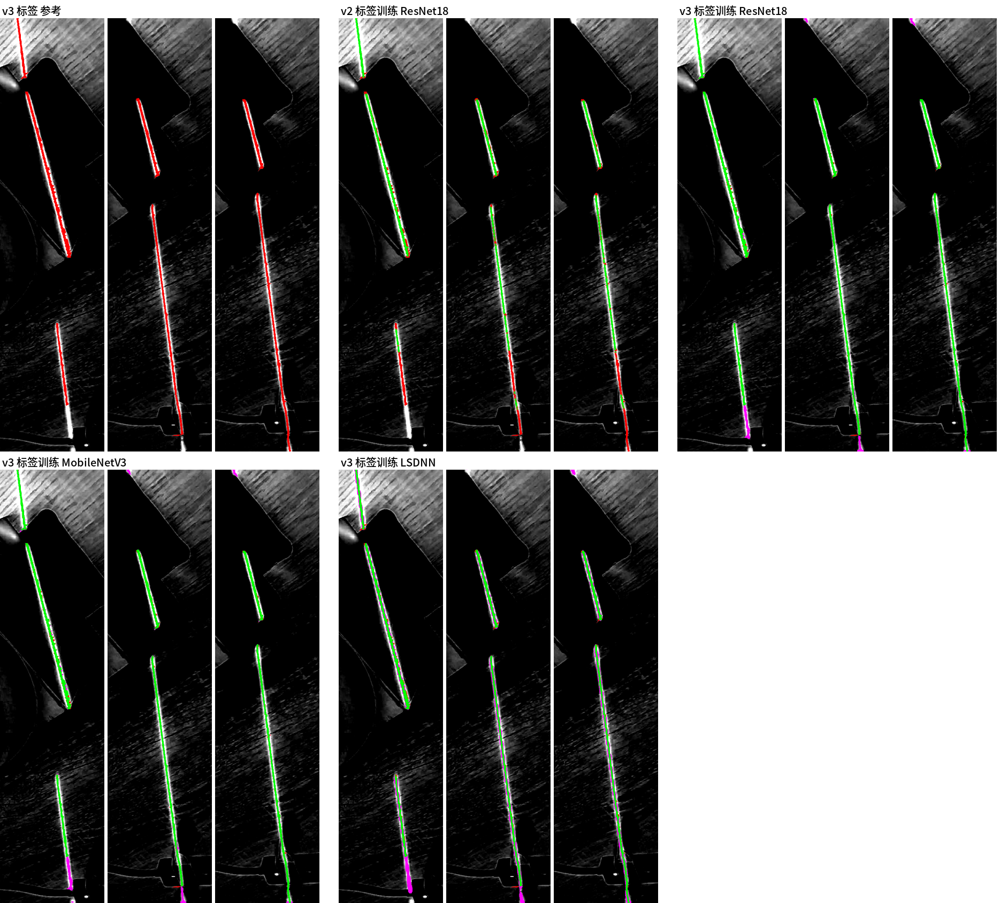

观察如下。

- 第二个面板，v2 训练的 ResNet18 在下半段有大段红色，即漏掉了暗淡的远场条纹。第三个面板，v3 训练后基本全绿。
- 两个 U-Net 在条纹末端靠近线缆处都有少量品红，对应标签没有标出的底段。
- LSDNN 沿整条线有一圈品红，说明预测偏粗，并非漏检。训练损失仍高，属欠拟合。

## 10. 基础模型对比

| 项 | U-Net ResNet18 | U-Net MobileNetV3 | LSDNN |
|---|---|---|---|
| 结构族 | 编码器解码器，逐级跳连 | 同左 | DeepLabv3+ 风格，空洞卷积金字塔加解码器 |
| 基础骨干 | ResNet18 | MobileNetV3 large | ResNet18，可选 ResNet101、Xception、DRN、MobileNetV2 |
| 骨干特点 | 残差块，结构简单，GPU 友好 | 深度可分离卷积加注意力模块，参数少 | 同 ResNet18，layer4 作多重网格单元 |
| 上下文模块 | 无，靠深层感受野 | 无 | 改进 ASPP，膨胀率 1、3、12、18，输出步长 16 |
| 解码器 | 逐级上采样，每级与同分辨率特征拼接 | 同左 | 1/4 低层特征经 BiSeNet 风格特征融合模块，输出步长 4 后双线性上采样 |
| 输出分辨率 | 原分辨率 | 原分辨率 | 步长 4，靠插值恢复 |
| 设计目标 | 通用分割，细结构保留好 | 移动端高效 | 线激光提取，多类别，区分条纹、反光噪声、雾 |
| 参数量 M | 14.3 | 6.7 | 21.6 |
| 1080p fp16 ms | 11.6 | 11.4 | 6.1 |
| 本场景 IoU，v3 标签 | 0.898 | 0.886 | 0.653 |
| 本场景连续性 | 0 误断 | 0 误断 | 0 误断 |

要点如下。

- U-Net 解码器逐级回到原分辨率，细结构不丢，这对 3 px 宽的条纹很重要。
- MobileNetV3 参数少一半，但 1080p 下速度没有变化，因为耗时主要在高分辨率解码器和访存，不在骨干。
- LSDNN 的优势是上下文模块大感受野，适合大面积雾和反光，同时 6.1 ms 最快。我们的条纹很窄，上下文帮助有限。
- LSDNN 的步长 4 输出上限是 IoU 0.888，所以分辨率只能解释一部分差距，其余是欠拟合。它的论文设置是 1920x1920 输入，300 个 epoch，多类别，我们没有按此训练，也没有调参。
- 所以 LSDNN 的 0.65 反映的是"我们的协议下的开箱表现"，不能判定该架构不行。如果将来需要速度，值得单独调一轮。

## 11. 解码器与骨干的多种子对比

为了回答"更强的解码器或骨干是否值得换"，在 v3 标签上再训练 UNet++、MAnet 和 U-Net ResNet34，并给 U-Net ResNet18 补两个种子。每个配置 3 个种子，共 11 次训练，其余设置与前面相同：80 个 epoch，同一数据切分，同一损失。

### 11.1 指标

| 模型 | 参数量 M | IoU 均值 ± 标准差 | 三个种子的 IoU | 误断帧数 | 1080p fp16 ms |
|---|---|---|---|---|---|
| U-Net ResNet18 | 14.3 | 0.8982 ± 0.0017 | 0.897、0.900、0.897 | 0、1、1 | 11.5 |
| UNet++ ResNet18 | 16.0 | **0.9053 ± 0.0035** | 0.903、0.904、0.909 | 2、1、1 | 34.2 |
| U-Net ResNet34 | 24.4 | 0.9006 ± 0.0021 | 0.902、0.898、0.902 | 2、4、6 | 13.2 |
| MAnet ResNet18 | 21.7 | 0.8682 ± 0.0246 | 0.845、0.894、0.866 | 0、0、0 | 13.4 |

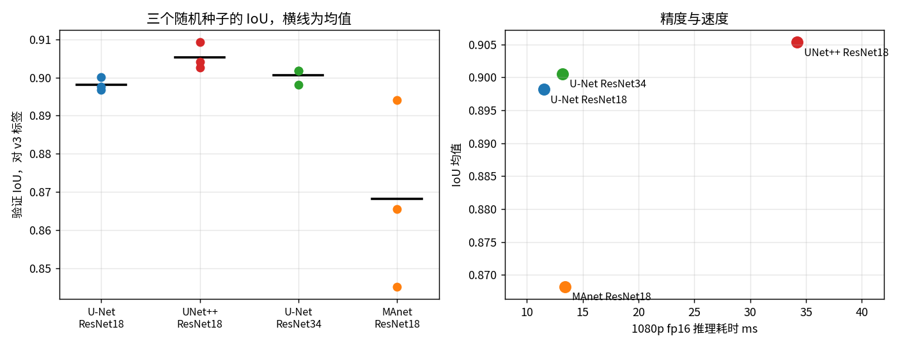

### 11.2 训练曲线

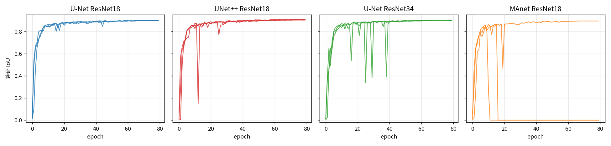

观察如下。

- 所有模型在训练中途都有验证 IoU 的突降，之后恢复，U-Net ResNet34 最频繁。末段曲线都已平稳。
- MAnet 有两个种子在第 10 和 16 个 epoch 附近 IoU 掉到 0 并且不再恢复，只有一个种子正常训完。表里的 0.845 和 0.866 对应的是按评分选出的早期 epoch 权重，分别在第 8 和 14 个 epoch。
- 所以 MAnet 的低分是训练不稳造成的，不能当作该架构的能力上限。原因没有排查，可能与混合精度或学习率有关。

### 11.3 逐帧差异

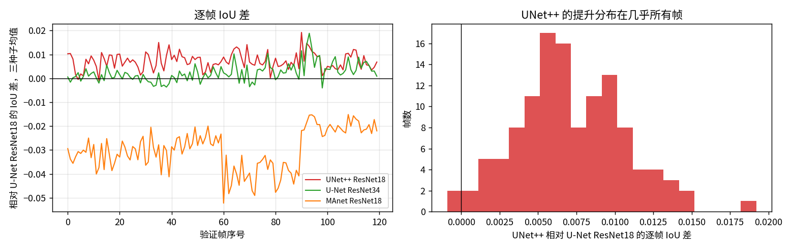

UNet++ 在 120 帧里有 118 帧高于 U-Net ResNet18，平均高 0.0072，最大 0.019。这是一个均匀的小幅提升，不集中在某几帧。U-Net ResNet34 的差值在零附近，没有稳定优势。

### 11.4 样例

绿色为命中，红色为标签有而模型漏掉，品红为模型多出。

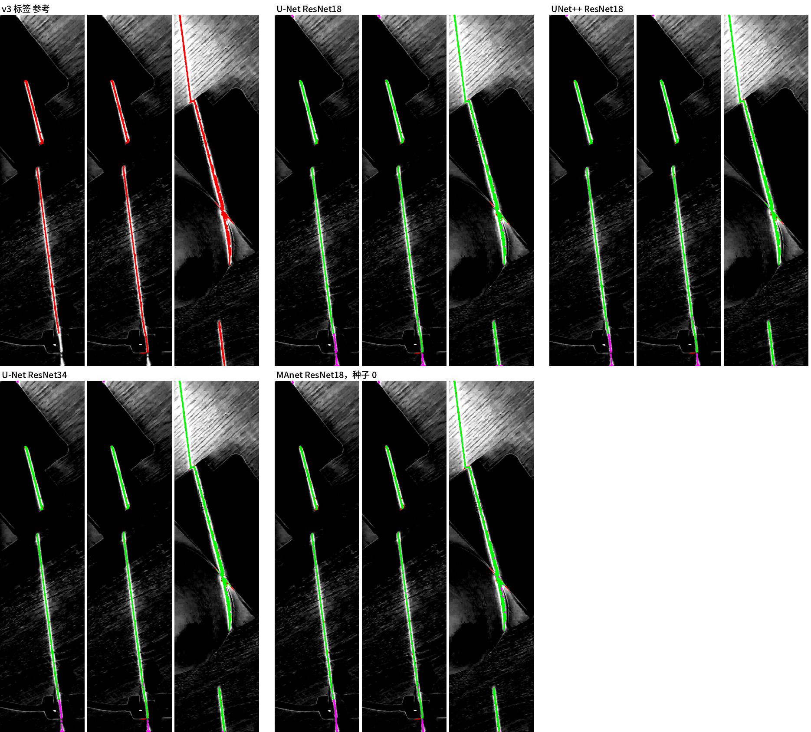

四个模型在可见层面几乎没有区别。差别只在条纹边缘一两个像素，以及末端靠近线缆处的少量品红，这是标签没有标出的底段。这与 IoU 差只有 0.007 一致，用肉眼无法分辨。

### 11.5 结论

- UNet++ 的提升是真实的，三个种子都高于基线的最高值，但幅度很小，并且推理慢约 3 倍。单帧 34 ms 在实时扫描里是明显代价。
- ResNet34 提升在噪声范围内，说明骨干容量不是当前瓶颈。
- MAnet 暂不考虑，除非查清训练崩溃的原因。
- 这些数字仍然是对规则标签的一致程度。0.007 的差距在没有人工真值前，不能说明真实中心精度的差别。
- 误断帧数现在不是全 0，基线为 0、1、1，说明前面单种子的 0 有一点运气成分。这个指标的证据图与标签规则同源，数字很小，不应过度解读。

## 12. 局限

| 问题 | 影响 |
|---|---|
| MobileNetV3 和 LSDNN 只训练一次 | ResNet18 与 MobileNetV3 的 0.011 差距可能落在随机波动内 |
| MAnet 训练不稳 | 原因未排查，其结果不代表架构上限 |
| 验证帧相邻且相关 | 120 帧的有效样本远少于 120 |
| 只有木质、环境光、近垂直条纹 | 金属和塑料的高光表现完全未知 |
| 标签仍由规则生成 | 模型在复现规则，不能证明它在规则失效处可靠 |
| 连续性证据图与标签规则同源 | v3 模型得 0 误断部分是循环论证 |
| 中心点没有真值 | 没有验证亚像素精度，只有分割指标 |
| v3 标签有小瑕疵 | 球边缘多出一小段，线缆附近底段未标 |
| LSDNN 未调参 | 结论只对我们的协议成立 |
| 中心提取慢 | 约 63 ms，来自 Python 循环，应向量化 |
| 导出未复核 | 彩色模型的 ONNX 与 TensorRT 导出没有重新验证 |

## 13. 下一步

1. 人工标注 30 到 50 帧的条纹中心线，覆盖缺口与远场，作为真值，同时检验亚像素精度和连续性。
2. 增加后处理，只在 B 通道有证据的缺口处补线，真缺口不补。
3. 采集金属和塑料工件的扫描数据，这是最关键的一步，优先拍有大面积高光的帧。
4. 用新数据重做对比，MobileNetV3 补种子，视需要尝试 BiSeNetV2 或 STDC，并给 LSDNN 调一轮。UNet++ 作为精度优先时的候选保留。
5. 修正 v3 标签的两处小瑕疵。
6. 向量化中心提取，目标压到 10 ms 以内，并复核 TensorRT 导出。

## 14. 新场景实测：cam_snaps 的 16 张图

`~/cam_snaps` 里有 16 张 1920x1080 无损 PNG，2026-10-30 11:54 到 11:55 抓拍。场景与训练数据完全不同：灰白墙面、黄色安全帽、透明杯子、深色线缆，条纹是斜线，与水平方向约 25 度，明显更宽更亮，呈青白色并带光晕。训练数据是近竖直、约 3 px 宽的木面条纹。所以这是一次域外测试。

对每张图跑六种方法。传统方法的扫描轴改为列方向，因为条纹接近水平。网络掩膜取转置输入的预测，因为转置后条纹更接近训练时的朝向。

### 14.1 汇总

| 方法 | 每帧点数均值 | 最少到最多 | 点数少于 100 的帧 |
|---|---|---|---|
| 传统 Steger | 1758 | 1707 到 1795 | 0 / 16 |
| 传统 质心 | 1918 | 1902 到 1920 | 0 / 16 |
| R18 掩膜加 Steger | 414 | 212 到 571 | 0 / 16 |
| R18 掩膜加蓝通道质心 | 386 | 85 到 775 | 1 / 16 |
| UNet++ 掩膜加 Steger | 112 | 0 到 240 | 8 / 16 |
| UNet++ 掩膜加蓝通道质心 | 87 | 0 到 203 | 8 / 16 |

网络掩膜面积也说明问题。R18 平均 748 px（原朝向）和 2783 px（转置），UNet++ 为 328 px 和 660 px。条纹实际长度约 1500 px、宽 6 到 10 px，所以完整掩膜应有上万像素。

### 14.2 图例

红点为提取的中心。图像已提亮。

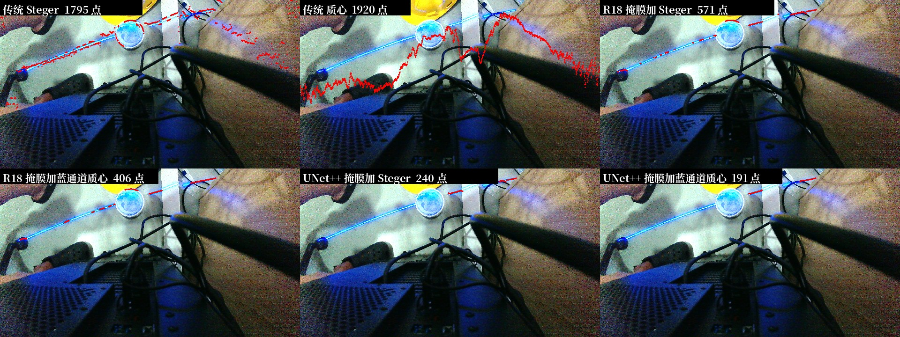

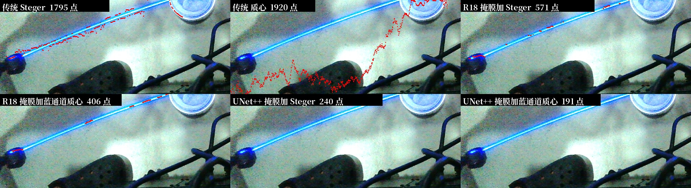

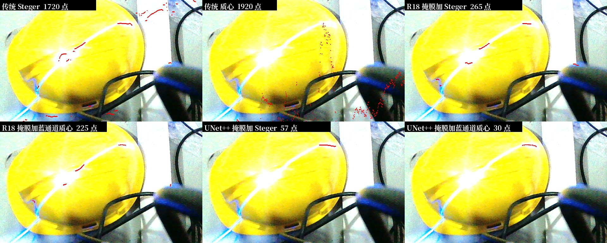

其余两帧见 `fig/snap_overview_1.jpg`、`snap_overview_2.jpg`、`snap_overview_3.jpg`。

### 14.3 观察

- 传统质心完全失效，点数几乎等于图像宽度 1920，说明每列都取到了某个东西，但轨迹沿着墙面阴影和线缆乱跑，最大偏离数百像素。它的参数是为木面场景调的，没有门控。
- 传统 Steger 沿墙面段能跟住条纹，但有大量杂点，出现在手臂、线缆、右上角的蓝色反光上，沿条纹的点也有约 2 到 3 px 的散布，没有明显的单点中心线。安全帽上，高光区和曲面段基本丢失。
- 网络加 Steger 或蓝通道质心，保留下来的点很干净，几乎没有杂点，但只覆盖条纹的一小部分。R18 比 UNet++ 好得多，UNet++ 有一半的帧几乎检不出。
- 这次 UNet++ 更差，不能说明它整体更差。它只是更紧地拟合了训练分布，域外时更保守。这一点和前面的 IoU 小幅领先并不矛盾，但提醒我们，训练集内的 IoU 差距不能预测换场景后的表现。
- 转置输入比原朝向好得多，说明网络对条纹朝向很敏感，训练时没有做旋转增强。

### 14.4 结论

- 这 16 张图没有真值，上面都是目视判断，不是精度数字。我试过用点的局部抖动当指标，但图里有多段条纹和杂点，数值没有意义，所以没有放进表里。
- 现有模型不能直接用于新场景。原因不是网络结构，而是训练数据只有近竖直、窄、木面的条纹，域差距很大。
- 要想用这批数据，需要把它们纳入训练：按 v3 方法生成标签，或手工标注，并加入旋转增强和宽条纹的尺度增强。
- 传统方法在这类场景下并不是更好：覆盖更全，但杂点多，质心版本不能用。
- 要判断提取精度，需要有标定板或球体的图像。这 16 张里没有标定板，不能做平面残差。

## 15. 自动标注与方法对比（cam_snaps）

按"可以 你先自动标注试试吧"，用 B-R（蓝色过量）脊线证据自动生成 16 帧的中心线：沿法向做非极大抑制，再做抛物线亚像素细化，只保留长度不小于 40 px 的链。这批中心线只是真值候选，**不是真值**。它与 `rule4` 标签、微调网络的训练标签用的是同一种证据，所以下表衡量的是"和这套规则的一致程度"，不是真实精度。

评估方式：对每个方法的中心点，算到自动标注点的最近距离。精度是 3 px 内的点占该方法全部点的比例，召回是自动标注点中 3 px 内有该方法点的比例，距离统计只取 3 px 内的点。

注意数据划分。杯子场景（6 帧）在微调时留作验证，是留出的；安全帽场景（10 帧）参与了微调训练，所以微调模型在该组的数字偏乐观。

### 15.1 杯子场景（留出，6 帧）

| 方法 | 精度 | 召回 | 近点中位距 px | 近点 p90 px | 点数 |
|---|---|---|---|---|---|
| 传统 Steger | 0.09 | 0.12 | 0.82 | 2.39 | 1775 |
| R18 掩膜加 Steger | 0.47 | 0.14 | 1.40 | 2.78 | 458 |
| R18 掩膜加蓝通道质心 | 0.37 | 0.08 | 0.62 | 2.38 | 297 |
| 微调 R18 掩膜加 Steger | **0.85** | **0.61** | **0.48** | **1.01** | 1177 |
| 微调 R18 掩膜加蓝通道质心 | 0.52 | 0.46 | 2.24 | 2.87 | 1058 |

### 15.2 安全帽场景（参与微调，10 帧）

| 方法 | 精度 | 召回 | 近点中位距 px | 近点 p90 px | 点数 |
|---|---|---|---|---|---|
| 传统 Steger | 0.09 | 0.26 | 0.58 | 2.56 | 1749 |
| R18 掩膜加 Steger | 0.36 | 0.22 | 0.47 | 1.93 | 388 |
| R18 掩膜加蓝通道质心 | 0.31 | 0.22 | 0.35 | 1.41 | 440 |
| 微调 R18 掩膜加 Steger | 0.73 | 0.65 | 0.57 | 1.38 | 519 |
| 微调 R18 掩膜加蓝通道质心 | 0.55 | 0.60 | 0.70 | 2.60 | 661 |

### 15.3 读法

- 微调后覆盖明显提升：召回从 0.14 升到 0.61（杯子，留出），点的精度从 0.47 升到 0.85。这是目前唯一有留出数据支撑的明确进步。
- 传统 Steger 精度只有 0.09，说明它 90% 以上的点落在证据线之外，即杂点；这与第 14 节目视结论一致。
- 微调模型加 Steger 优于加蓝通道质心。蓝通道质心在宽条纹上被光晕和饱和核心拉偏，中位距 2.24 px。宽条纹的中心提取需要单独设计。
- 召回仍只有 0.6 左右，高光缺口处没有点，没有桥接。
- 0.5 px 左右的中位距不能当作精度。自动标注与 Steger 同属脊线类方法，彼此一致是预期的；所有"近点"统计还排除了 3 px 外的点。
- 这批帧里没有规则做不到而网络做到的证据：网络学的就是规则，它的价值目前是"把规则的误检压下去并连起来"，而不是"超过规则"。要回答"网络是否优于规则加 Steger"，需要在高光、遮挡帧上手工标几帧中心线。

## 16. 帽子和水杯：换特征加追踪加核心精修

第 15 节之后查看放大图，发现之前所有方法的问题比"杂点多、覆盖少"更根本。

### 16.1 发现一：蓝色光晕是单侧的，之前的中心点偏离亮核 2 到 7 px

墙面上条纹的横截面（帧 115507，垂直于条纹方向取一列）如下。

| 位置 | 内容 |
|---|---|
| 约 -7 到 +2 px | 只有 B 高（200 到 255），G、R 与墙面相同。这是单侧蓝色光晕 |
| 约 +3 到 +7 px | B、G 同时饱和（255），R 约 100 到 170，白青色亮核 |
| +8 px 以外 | 回到墙面值 |

B-R、B 通道和以 B 为主的规则，其脊线都落在光晕中间，而不是亮核上。传统 Steger、网络加 Steger 和旧的自动标注都是如此。第 15 节里"自动标注"那张图里中心线画在条纹两侧，就是这个原因。我把核心位置取为 min(B, G) 的峰，即 B、G 同时高的地方。要注意，这是我的判断：激光的物理中心更可能是最亮的核心，但没有几何验证。如果相机有 B 通道横向色差，真值可能介于两者之间，需要用平面或球体残差确认。

### 16.2 发现二：帽子上 B-R 特征失效

黄色安全帽表面 R 很高，B-R 为很大的负值，白核心的 B-R 也到不了零以上，所以截断到零的 B-R 特征在帽子上什么都看不到。改用局部对比特征：B 减局部中值背景，加 (B-R) 减局部中值背景，各自截断到零再相加。这个特征在帽子和高光斑块上给出连续的单峰脊线，在墙面上也是单峰。

### 16.3 新流程

1. 特征 F 取局部对比，沿法向做非极大抑制，得到若干条链。
2. 过滤链：长度不小于 60 点，平均 F 不小于 140。
3. 用动态规划在链之间找一条总分最大的路径，相邻链端点间隙不超过 300 px，方向夹角不超过 60 度。间隙用直线补点，标为插值点（图中黄色）。
4. 沿路径法向用 min(B, G) 在 ±12 px 内找亮核，取半高以上区段的加权质心，对比度不足的点丢弃。

这是纯经典方法，没有用网络。

### 16.4 结果

水杯场景，墙面段 x 在 150 到 650 的点，每个方法拟合二次曲线后的残差（越小越平滑），共 6 帧：

| 方法 | 每帧点数 | 覆盖 | 残差 RMS px | p95 px |
|---|---|---|---|---|
| 传统 Steger | 366 | 0.87 | 8.37 | 15.16 |
| R18 掩膜加 Steger | 90 | 0.27 | 2.25 | 4.77 |
| 微调 R18 掩膜加 Steger | 499 | 1.01 | 1.83 | 2.34 |
| 微调 R18 掩膜加蓝通道质心 | 444 | 1.01 | 1.30 | 3.04 |
| 规则加追踪加核心精修 | 908 | 0.98 | **0.52** | **0.55** |

注意事项：这个残差衡量的是点沿曲线的平滑程度，即重复性，不是精度。选取范围用追踪结果划定，对所有方法一样但对新方法略有利。比较中也不含偏置：新方法的中心线比旧方法整体向亮核偏 2 到 7 px。

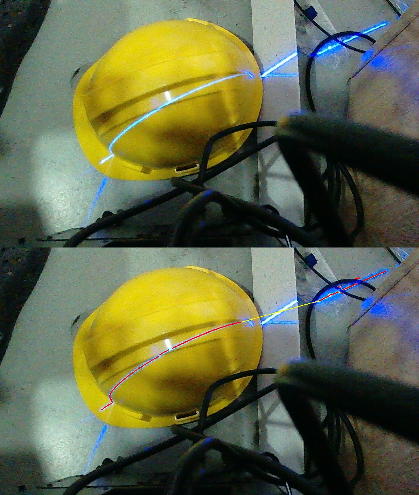

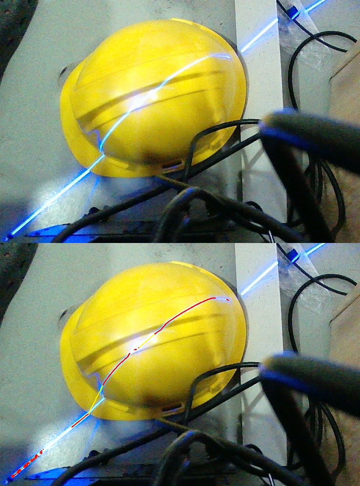

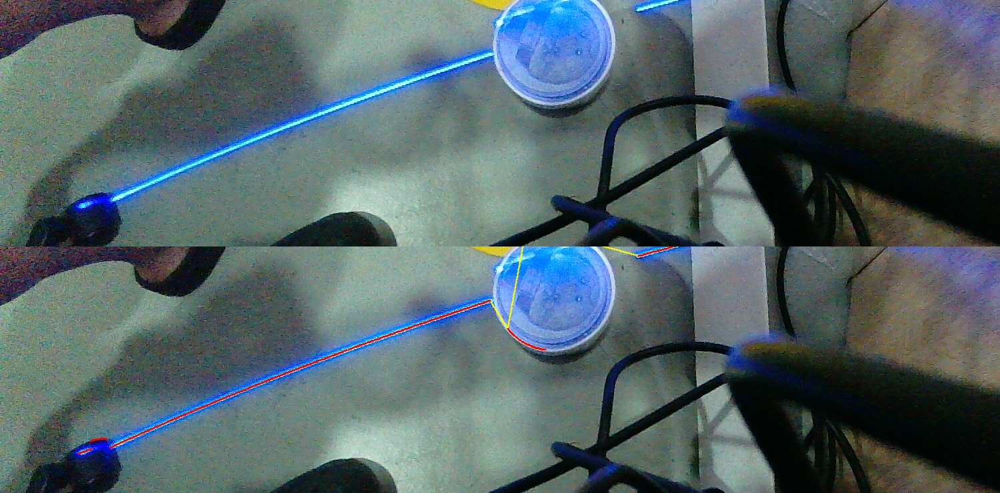

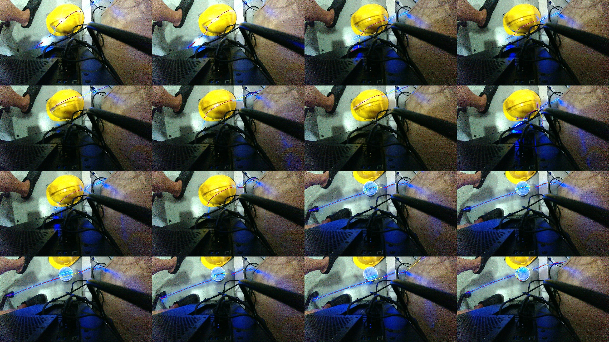

### 16.5 目前做到什么程度

- 帽子：多数帧里一条完整中心线从墙面进入帽沿，穿过高光斑块，到帽顶，高光处用插值衔接，不再断。
- 水杯：墙面段中心线落在亮核上，残差 0.5 px 左右。杯子本身是透明的，条纹穿过杯子的部分只做了直线插值，右侧台阶后的条纹有跳变，这一段不可信。
- 仍有失败帧：115425 有一段竖直的错误连接，115439 在线缆附近绕路，115441 和 115501 缺少某一段。阈值（链长、平均 F、间隙、夹角）是我对着这 16 帧调的，换场景需要重新验证，不能说成泛化。
- 这个流程不依赖网络。在这两个场景下，网络不是必须的，规则加追踪就够用了。网络若要有价值，要证明它在规则会失败的帧（线缆干扰、遮挡）上更稳，目前没有这个证据。
- 中心点的真实精度仍未知。需要标定板、球体或已知尺寸物体做平面残差。

## 附录：文件位置

| 内容 | 位置 |
|---|---|
| 报告图片 | `~/Downloads/stripe_results/report/fig/` |
| 训练脚本与标签脚本 | 远程 `~/stripe_seg/stripe_unet/`，本地 `/tmp/stripe_unet/` |
| v3 标签脚本 | `hyst_labels.py`，加 `make_color_labels.py --hyst` |
| 连续性评估 | `eval_cont.py`，结果 `eval_cont.json` |
| 训练日志 | 远程 `~/stripe_seg/runs/*.log`，本地 `/tmp/logs/` |
| 模型权重 | 远程 `~/stripe_seg/runs/scan3_r18/best.pt`、`scan3_mbv3`、`scan3_lsdnn` |
| 标签数据 | 远程 `~/stripe_seg/data_scan_v3`，本地 `/tmp/data_scan_v3` |
| 多种子对比 | 远程 `~/stripe_seg/runs/scan3_{UnetPlusPlus,MAnet}_resnet18_s{0,1,2}`、`scan3_Unet_resnet34_s*`、`scan3_Unet_resnet18_s{1,2}`，评估 `eval_cont_multi.json`，排队脚本 `~/stripe_seg/queue.sh` |
| LSDNN 源码 | 远程 `~/stripe_seg/LSDNN` |
